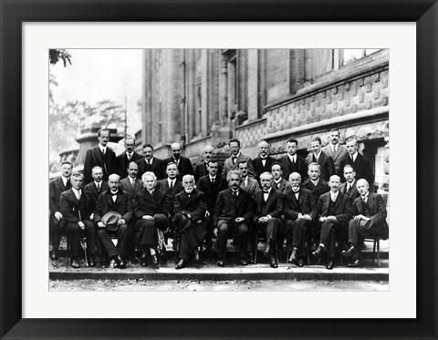

Hi!

International Relations

- ML in finance, economics and entertainment fields
- Primary tech stack: Python, C++, Javascript, React, Typescript, C
- Experimenting mathematical formulas with code.
- Previously worked on Graph Neural Networks, currently working on Neural Networks, NLP and LSTMs.
- Interested in working on NLP and Linguistics

  

